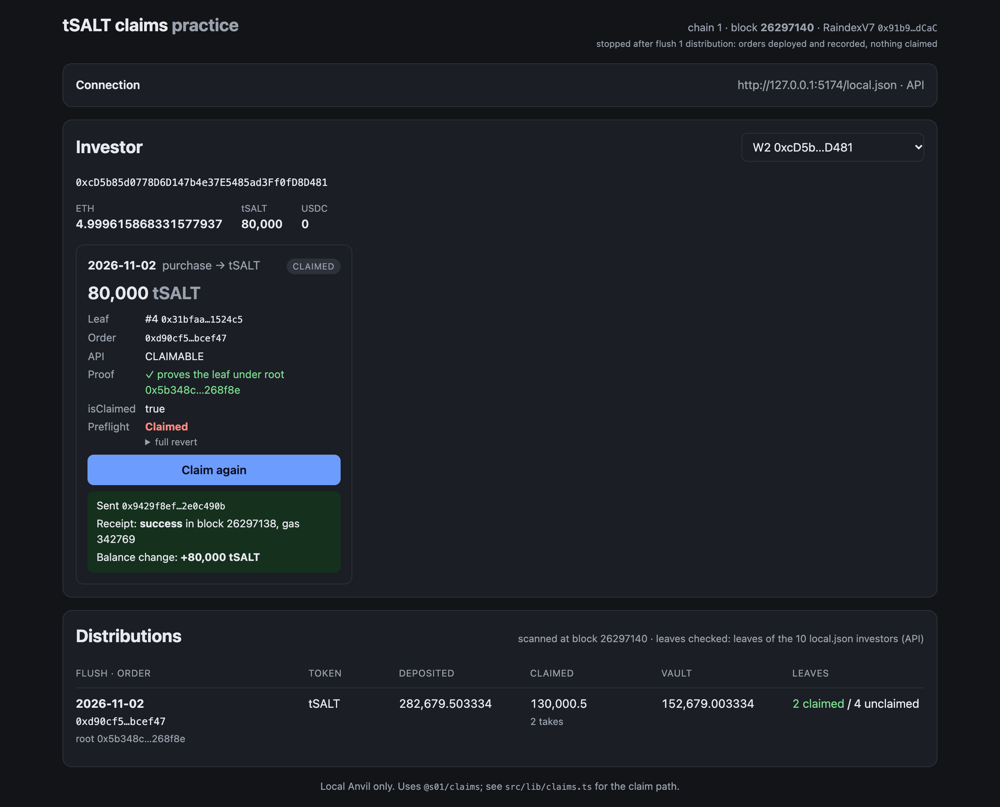

# claim-ui: practise tSALT claims on a local chain

A small Vite + Svelte 5 page that claims `claims.rain` distributions on a local Anvil with `@s01/claims`. It is
also the reference integration for SALT's UI: the whole claim path is in [`src/lib/claims.ts`](src/lib/claims.ts)
(get the claim → `prepareClaim` → `verifyProof` / `isClaimed` / `simulateClaim` → send `{ to, data }` → re-check).

Local only: the page talks to the Anvil RPC and, if configured, tsalt.api, nothing else.



## Run

```bash
cd examples/claim-ui
npm install          # links @s01/claims from ../.. (its dist/ is rebuilt by every script below)
```

**Against the e2e harness** (`e2e/2026-10-29-mainnet-fork`, started with `E2E_STOP_AT=dist1 ./run.sh`):

```bash
npm run dev          # http://127.0.0.1:5173 – serves the harness's local.json at /local.json
```

**Standalone** (no harness, no API): a mainnet-fork Anvil with two small USDC claim orders.

```bash
npm run demo         # terminal 1: forks https://ethereum-rpc.publicnode.com on :8646, deploys, writes .demo/; Ctrl-C stops it
npm run dev:demo     # terminal 2: http://127.0.0.1:5173 with .demo/local.json
```

The demo deploys with `s01.distributions` (operator side, `raindex-v7` branch, `npm ci` done) from
`../../../../s01.distributions`. Override with `FORK_URL=…`, `PORT=…`.

**Without a browser**, the same `src/lib/claims.ts` code from Node:

```bash
npm run verify -- .demo/local.json D2                 # claim every leaf of D2, then expect the "Claimed" refusal
npm run verify -- <local.json> W3 --preflight-only     # proof, isClaimed and preflight only; sends nothing
```

`npm run check` type-checks the app and scripts.

## What it shows

- **Connection**: `/local.json` (from `CLAIM_UI_LOCAL`, default the harness's), `?config=<url>`, paste/upload, or
  manual RPC / API / proofs URLs. With an `apiUrl` the claims come from `GET /v1/wallets/{a}/purchases|redemptions`
  (proxied by the dev server, since the API restricts CORS); without one, from the `proofs` file named in local.json.
- **Investor**: pick a local.json investor (its test key signs in the page) or an injected wallet. An injected wallet
  is switched to the config's chain id and must report the same latest block hash as the Anvil RPC, so a wallet on
  real mainnet (also chain id 1) is refused. Balances (ETH, tSALT, USDC) and every claim with its local proof check,
  `isClaimed` and the `simulateClaim` preflight, re-read every block. **Claim** preflights again and sends; a claim
  that would revert is not sent and shows the strategy's reason (`Claimed`, `Proof`).
- **Distributions**: every order added on the orderbook since the fork block (`AddOrderV3`), with deposits
  (`DepositV2`), claimed amount and takes (`TakeOrderV4`), vault balance, and claimed/unclaimed counts of the leaves
  it knows (all leaves from a proofs file; the local.json investors' leaves from the API). Re-scanned every block.
- `?investor=W1` preselects an investor.

## local.json

The harness's shape; only `rpcUrl` is required:

```jsonc
{
  "rpcUrl": "http://127.0.0.1:8645", "chainId": 1,
  "apiUrl": "http://127.0.0.1:8000",          // or null, with "proofs": "proofs.json" (next to local.json)
  "forkBlock": 26296800,                       // optional: default anvil_nodeInfo's fork block
  "contracts": { "orderbook": "0x91b9…", "tSALT": "0xaAb1…", "usdc": "0xA0b8…" },
  "distributions": [{ "flush": "2026-11-02", "token": "tSALT", "orderHash": "0x…", "root": "0x…" }],
  "investors": [{ "name": "W1", "address": "0x…", "privateKey": "0x…" }]
}
```

`proofs.json` is `{ "orders": [{ flush, token, orderHash, root, order, leaves: [{ wallet, index, amount, proof }] }] }`:
each leaf is the API's `claim` object plus the wallet.

Screenshots in [`docs/`](docs) were taken from this page in headless Chrome (desktop and 390 px).
